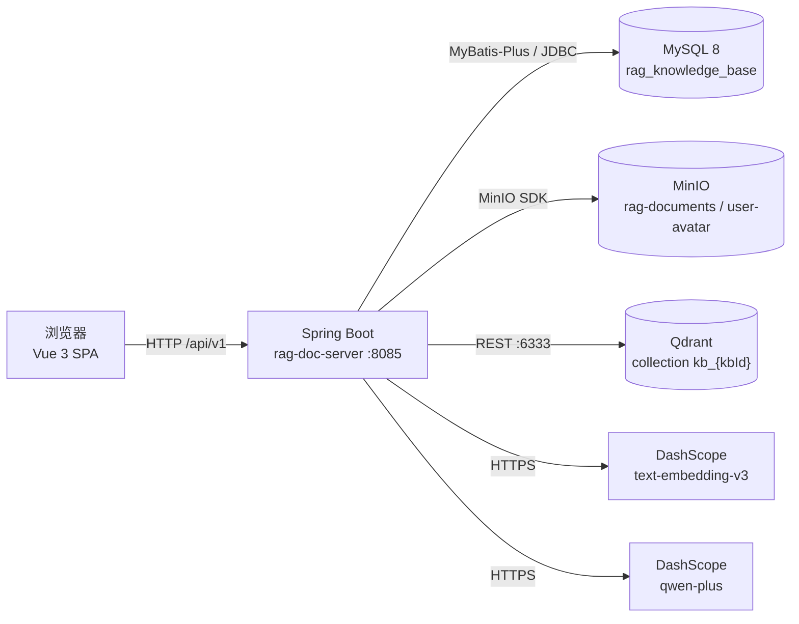
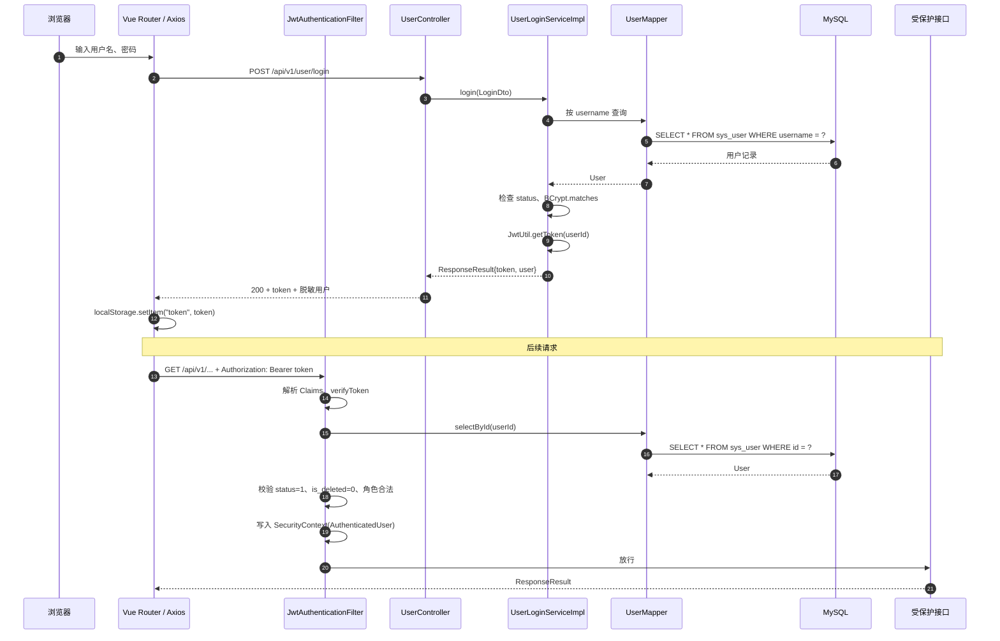
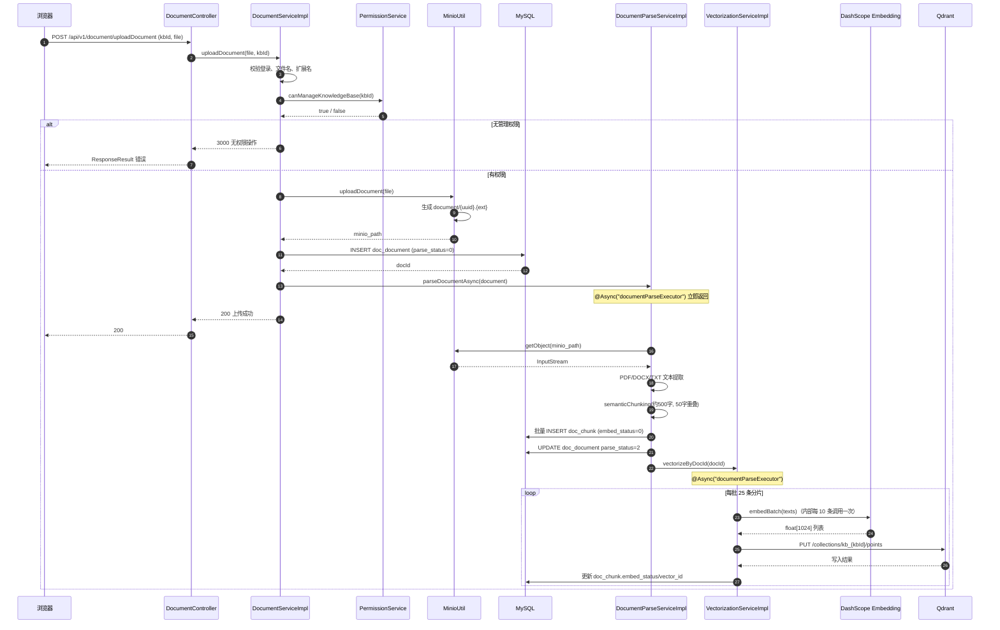
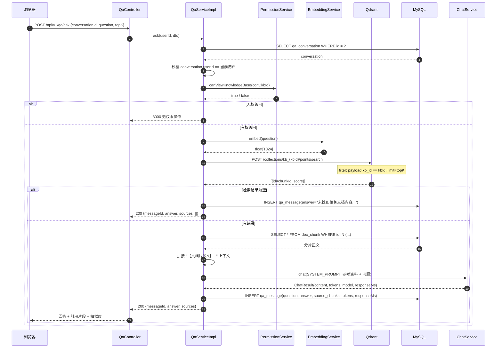
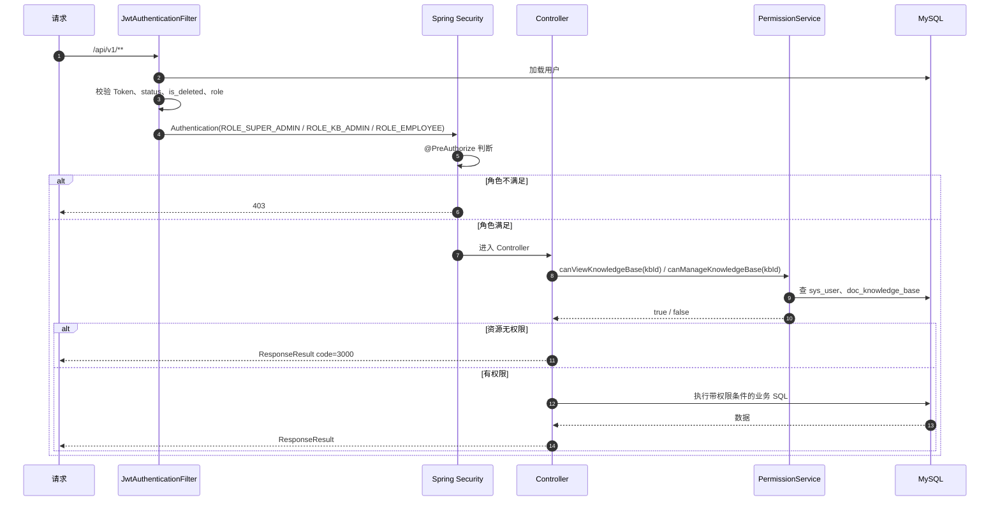
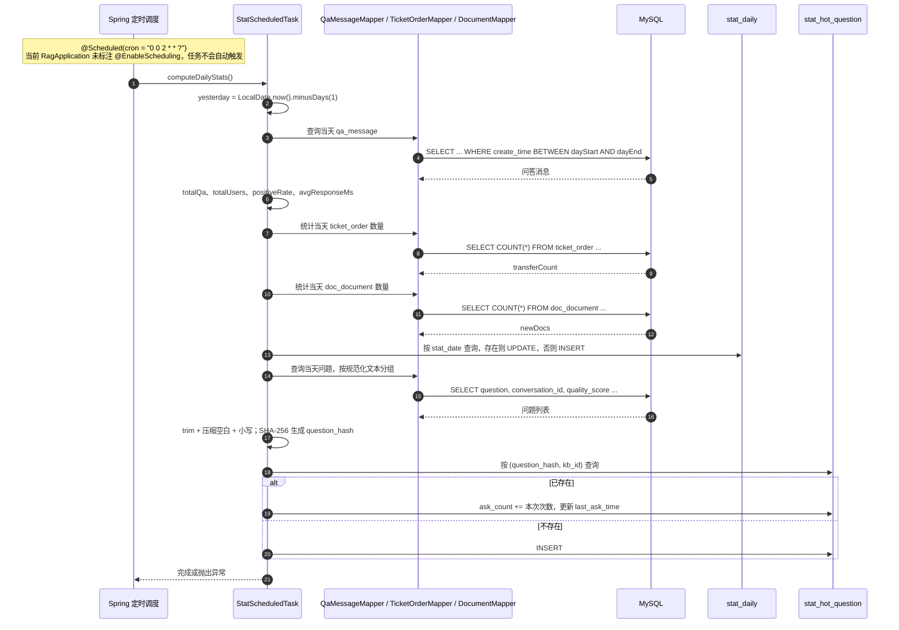

# RAG KnowledgeNexus 开发文档

**文档类型：** 基于代码的实现说明（as-built）  
**编写日期：** 2026-11-20  
**代码基线：** `main` 分支提交 `7a2db89`，并核对当前工作区未提交改动（未提交改动不纳入提交）  
**说明：** 本文只描述仓库中实际存在的能力。设计阶段提出但代码未实现的内容，统一在第 9 节列明，不当作已实现功能。

---

## 1. 项目概览

RAG KnowledgeNexus 是一个前后端分离的企业知识库问答系统：用户把 PDF、DOCX、TXT 文档上传到知识库，后端异步解析、分片并调用 Embedding 接口生成向量，写入 Qdrant；提问时先做向量检索，再把检索到的分片交给大模型生成回答，并保存问答记录、引用来源和用户反馈。

仓库是一个 Git 仓库，前端和后端都在同一仓库中：

```text
RAG-KnowledgeNexus/
├── backend/rag-knowledgenexus/     # Spring Boot 多模块后端
├── frontend/                       # Vue 3 前端
├── docs/                           # 项目文档
├── files/                          # 数据库初始化脚本等资料
├── tools/                          # 文档 PDF 生成脚本
├── logs/                           # 运行日志（已被 .gitignore 忽略）
├── lucene-index/                   # 历史遗留目录（已被忽略，当前代码不使用 Lucene）
└── 2026-11-20/                     # 本次文档整理的工作目录（未跟踪）
```

### 1.1 已实现的功能

| 模块 | 实际实现 |
| --- | --- |
| 登录注册 | 用户名密码登录、注册、JWT 签发、获取当前用户、修改资料/密码、头像上传 |
| 用户管理 | 超级管理员分页查询、启用/禁用、逻辑删除 |
| 部门管理 | 部门树、平铺列表、部门成员；超级管理员增删改 |
| 知识库 | 分页列表、详情、创建、修改、删除、收藏切换、名称列表 |
| 文档 | 上传、分页查询、详情、预览地址、改名、逻辑删除、重新解析、按知识库查询 |
| 解析与分片 | PDF（PDFBox）、DOCX/DOC（POI）、TXT（UTF-8）文本提取；约 500 字符、50 字符重叠的语义分片 |
| 向量化 | DashScope `text-embedding-v3`，1024 维；分批调用；写入 Qdrant |
| 检索问答 | 问题向量化、Qdrant Top-K 检索、MySQL 反查分片、拼 Prompt 调用 `qwen-plus`、保存引用与耗时 |
| 反馈 | 对 `qa_message` 写入 `quality_score`（1 或 -1） |
| 工单 | 创建、按角色过滤列表、管理员解决 |
| 统计 | 每日 02:00 的统计任务代码、日统计查询、热门问题查询（任务启用问题见 9.1） |
| 前端页面 | 登录、工作台、知识库列表/详情、文档、问答、工单、用户、部门、个人中心 |

### 1.2 代码中不存在的功能

以下能力**没有**在本仓库代码中实现，相关旧文档已按第 2 节说明清理：

- Milvus、Lucene 向量检索（当前只使用 Qdrant REST API）。
- BM25 关键词检索、RRF 融合排序、Reranker 重排序。
- SSE、WebSocket 流式回答。
- Redis 缓存、Redis 限流、Redis Token 黑名单（虽然引入了 Redis 依赖和配置，但没有任何代码使用）。
- Dockerfile、Docker Compose、Kubernetes 部署文件。
- 消息队列、解析任务表、补偿任务表、失败任务自动重试。
- OCR、图片/音视频知识库、文档在线协同编辑。

---

## 2. 系统架构

### 2.1 运行时拓扑



前端开发服务器（Vite，5173）通过 `vite.config.ts` 把 `/api` 代理到 `http://localhost:8085`；生产环境需要由 Nginx 或同类静态服务器托管 `dist` 并反向代理后端。

### 2.2 后端模块划分

后端是 Maven 多模块工程，父工程为 `backend/rag-knowledgenexus/pom.xml`。

| 模块 | 包/职责 | 主要内容 |
| --- | --- | --- |
| `rag-doc-common` | 公共能力 | 常量、枚举、JWT 工具、MinIO 工具、配置属性类 |
| `rag-doc-model` | 数据模型 | POJO、DTO、VO、统一响应 `ResponseResult`、业务码 `AppHttpCodeEnum` |
| `rag-doc-server` | 主服务 | Controller、Service、Mapper、配置、异步任务、定时任务、测试 |

`rag-doc-server` 的主要包：

```text
com.xxr
├── RagApplication.java              # 启动类、MyBatis-Plus 分页插件
├── config/                          # Security、MinIO、WebMvc、异步线程池
├── controller/v1/                   # 7 个 REST Controller
├── security/                        # JWT 过滤器、登录主体、当前用户工具
├── service/                         # 业务接口
├── service/impl/                    # 业务实现
├── mapper/                          # MyBatis-Plus Mapper
├── task/StatScheduledTask.java      # 每日统计任务
└── resources/
    ├── application.yml              # 公共配置 + prod profile
    ├── application-dev.yml          # dev profile
    └── com/xxr/mapper/*.xml         # 自定义 SQL
```

### 2.3 前端模块划分

```text
frontend/src
├── api/            # axios 封装与各业务接口
├── components/     # AppLayout、Navbar、Sidebar、TagsView
├── router/         # hash 路由与登录守卫
├── stores/         # Pinia：user、app、tagsView
├── types/          # TypeScript 类型
├── views/          # 页面
│   ├── login/            LoginView.vue
│   ├── dashboard/        DashboardView.vue
│   ├── knowledgeBase/    KBListView.vue、KBDetailView.vue
│   ├── document/         DocumentView.vue
│   ├── qa/               QAView.vue
│   ├── ticket/           TicketView.vue
│   ├── user/             UserManage.vue、DepartmentManage.vue
│   └── profile/          ProfileView.vue
└── assets/styles/  # Tailwind + SCSS 变量
```

### 2.4 一次普通请求的链路

```text
页面
  -> axios 请求拦截器附加 Authorization: Bearer <token>
  -> Spring Security 过滤链
  -> JwtAuthenticationFilter 解析 Token、加载用户、写入 SecurityContext
  -> Controller
  -> Service（必要时调用 PermissionService 做资源级校验）
  -> Mapper / MyBatis-Plus
  -> MySQL
  -> ResponseResult
  -> axios 响应拦截器（code != 200 时提示错误）
```

---

## 3. 技术栈与实际版本

### 3.1 后端

版本取自 `backend/rag-knowledgenexus/pom.xml`、各子模块 `pom.xml`。

| 技术 | 实际版本/来源 | 用途 |
| --- | --- | --- |
| Java | 17 | 编译与运行 |
| Spring Boot | 2.7.18 | Web、依赖管理、自动配置 |
| Spring Security | 由 Spring Boot 2.7.18 管理（5.7.x） | 无状态认证、方法级授权 |
| JJWT | `jjwt-api` 0.12.5，`jjwt-impl`/`jjwt-jackson` 0.12.3 | JWT 生成与校验（HS256） |
| MyBatis-Plus | 3.5.3.1 | ORM、分页、逻辑删除 |
| PageHelper | 1.4.6 | 依赖存在，业务代码主要使用 MyBatis-Plus 分页 |
| MySQL 驱动 | `mysql-connector-j` 8.0.33 | JDBC |
| MinIO Java SDK | 8.5.11 | 文档/头像对象存储、预签名 URL |
| Apache PDFBox | 3.0.2 | PDF 文本提取 |
| Apache POI | 5.2.5（`poi-ooxml`） | DOCX 段落与表格提取 |
| OkHttp | 4.12.0 | 调用 Embedding、Chat、Qdrant REST |
| fastjson | 2.0.49（代码使用 `com.alibaba.fastjson2` API） | JSON 构造与解析 |
| Knife4j | 3.0.2 | Swagger 接口文档（`/doc.html`） |
| Lombok | 1.18.30 | 简化 POJO |
| Redis | `spring-boot-starter-data-redis` + `commons-pool2` | 仅引入依赖与配置，**代码未使用** |

### 3.2 前端

版本取自 `frontend/package.json`（`^`/`~` 为声明范围，实际安装版本以 lock 文件为准）。

| 技术 | 声明版本 | 用途 |
| --- | --- | --- |
| Vue | ^3.5.13 | 页面框架（Composition API） |
| TypeScript | ~5.7.3 | 类型检查 |
| Vite | ^6.2.4 | 开发与构建 |
| Vue Router | ^4.5.0 | hash 路由 |
| Pinia | ^3.0.1 | 用户/布局/标签页状态 |
| Element Plus | ^2.9.6 | 基础组件 |
| Axios | ^1.7.9 | HTTP 请求与拦截器 |
| ECharts / vue-echarts | ^5.5.1 / ^7.0.3 | 工作台图表 |
| Tailwind CSS | ^3.4.19 | 样式 |
| Sass | ^1.85.1 | SCSS |
| lucide-vue-next | ^0.577.0 | 侧边栏图标 |
| dayjs | ^1.11.13 | 日期处理 |

### 3.3 AI 与向量检索

| 组件 | 实际配置 |
| --- | --- |
| Embedding | 阿里云 DashScope `text-embedding-v3`，代码固定 1024 维 |
| Chat | 阿里云 DashScope `qwen-plus` |
| 向量库 | Qdrant，REST API，Cosine 距离 |
| Collection | 每个知识库一个 `kb_{kbId}` |
| Point ID | `doc_chunk.id` |
| Payload | `chunk_id`、`kb_id`、`doc_id`、`chunk_index`、`content`（最多 500 字符） |

---

## 4. 数据模型

### 4.1 MySQL 表

初始化脚本为 `files/rag_knowledge_base_ddl.sql`，数据库名 `rag_knowledge_base`，字符集 `utf8mb4`。DDL 共 12 张表。

#### 4.1.1 用户与权限

**`sys_dept` 部门表**

| 字段 | 类型 | 说明 |
| --- | --- | --- |
| `id` | BIGINT PK | 部门 ID |
| `name` | VARCHAR(50) | 部门名称 |
| `parent_id` | BIGINT | 父部门 ID，支持树形结构 |
| `sort` | INT | 同级排序 |
| `remark` | VARCHAR(200) | 备注 |
| `create_time` / `update_time` | DATETIME | 创建/更新时间 |
| `is_deleted` | TINYINT | 逻辑删除，0 未删除 / 1 已删除 |

索引：`idx_parent_id`、`idx_name`。

**`sys_user` 用户表**

| 字段 | 类型 | 说明 |
| --- | --- | --- |
| `id` | BIGINT PK | 用户 ID（MyBatis-Plus `ASSIGN_ID` 雪花算法） |
| `username` | VARCHAR(50) UNIQUE | 登录名 |
| `password` | VARCHAR(100) | BCrypt 哈希 |
| `nickname` | VARCHAR(50) | 显示名 |
| `email` | VARCHAR(100) | 邮箱 |
| `avatar_url` | VARCHAR(255) | 头像对象地址 |
| `role` | TINYINT | 0 超级管理员 / 1 知识库管理员 / 2 普通员工 |
| `dept_id` | BIGINT | 部门 ID |
| `status` | TINYINT | 0 禁用 / 1 正常 |
| `last_login_time` | DATETIME | 最近登录时间（当前登录流程未更新该字段） |
| `create_time` / `update_time` / `is_deleted` | | 公共字段 |

外键：`dept_id -> sys_dept.id ON DELETE SET NULL`。

**`sys_operation_log` 操作日志表**

字段：`id`、`user_id`、`module`、`action`、`target_id`、`ip`、`user_agent`、`cost_ms`、`result`、`error_msg`、`create_time`、`is_deleted`。  
代码中存在同名 POJO，但没有 Mapper/Service 写入该表，属于预留表。

#### 4.1.2 知识库与文档

**`doc_knowledge_base` 知识库表**

| 字段 | 类型 | 说明 |
| --- | --- | --- |
| `id` | BIGINT PK | 知识库 ID |
| `name` | VARCHAR(100) | 名称（业务层查重） |
| `description` | VARCHAR(500) | 描述 |
| `owner_id` | BIGINT | 所有者 |
| `visibility` | TINYINT | 0 私有 / 1 部门可见 / 2 全员可见 |
| `dept_id` | BIGINT | 部门可见时对应的部门 |
| `doc_count` | INT | 冗余计数字段（列表接口实际用 `count(d.id)` 计算） |
| `embed_model` | VARCHAR(50) | 默认 `text-embedding-v3` |
| `chunk_size` / `chunk_overlap` | INT | DDL 预留，代码未读取 |
| `create_time` / `update_time` / `is_deleted` | | 公共字段 |

**`doc_document` 文档表**

| 字段 | 类型 | 说明 |
| --- | --- | --- |
| `id` | BIGINT PK | 文档 ID |
| `kb_id` | BIGINT | 所属知识库 |
| `title` | VARCHAR(200) | 标题（上传时取去掉扩展名的文件名） |
| `file_name` | VARCHAR(200) | 原始文件名 |
| `file_type` | VARCHAR(20) | 扩展名，如 pdf/docx/doc/txt |
| `file_size` | BIGINT | 字节数 |
| `minio_path` | VARCHAR(500) | MinIO 对象地址 |
| `parse_status` | TINYINT | 0 待处理 / 1 解析中 / 2 完成 / 3 失败 |
| `parse_error` | TEXT | 失败原因 |
| `chunk_count` | INT | 分片数量 |
| `upload_user_id` | BIGINT | 上传用户 |
| `word_count` | INT | 提取文本字符数 |
| `page_count` | INT | DDL 预留，实体未映射 |
| `create_time` / `update_time` / `is_deleted` | | 公共字段 |

**`doc_chunk` 文档分片表**

| 字段 | 类型 | 说明 |
| --- | --- | --- |
| `id` | BIGINT PK | 分片 ID，同时作为 Qdrant Point ID |
| `doc_id` | BIGINT | 所属文档 |
| `kb_id` | BIGINT | 冗余知识库 ID |
| `chunk_index` | INT | 文档内顺序，从 0 开始 |
| `content` | LONGTEXT | 分片正文 |
| `content_length` | INT | 字符数 |
| `vector_id` | VARCHAR(100) | 向量 ID（实际写入 `chunk.id` 的字符串） |
| `embed_status` | TINYINT | 0 待向量化 / 1 成功 / 2 失败 |
| `page_num` | INT | 页码（当前分片统一为 1） |
| `source_type` | VARCHAR(20) | DDL 预留，代码未写入 |
| `create_time` / `update_time` / `is_deleted` | | 公共字段 |

DDL 还为 `content` 建了 `FULLTEXT ... WITH PARSER ngram` 索引，但代码没有 BM25/全文检索逻辑，该索引当前不被使用。

#### 4.1.3 问答与工单

**`qa_conversation` 对话表**

字段：`id`、`user_id`、`kb_id`、`title`、`msg_count`、`last_msg_time`、`create_time`、`update_time`、`is_deleted`。  
实体只映射了 `id/user_id/kb_id/title` 与公共字段，`msg_count`、`last_msg_time` 当前不维护。

**`qa_message` 问答消息表**

| 字段 | 类型 | 说明 |
| --- | --- | --- |
| `id` | BIGINT PK | 消息 ID |
| `conversation_id` | BIGINT | 所属对话 |
| `user_id` | BIGINT | 提问用户 |
| `question` | TEXT | 问题 |
| `answer` | LONGTEXT | 回答 |
| `source_chunks` | JSON | 引用分片 JSON，实际格式 `[{chunkId, content, score}]` |
| `tokens_used` | INT | 大模型总 token 数 |
| `response_ms` | INT | 大模型响应耗时（毫秒） |
| `quality_score` | TINYINT | 1 好评 / -1 差评 / NULL 未评价 |
| `is_transferred` | TINYINT | DDL 预留，代码未写入 |
| `llm_model` | VARCHAR(50) | 实际使用的模型名 |
| `search_type` | VARCHAR(20) | 前端可传，当前检索固定为向量检索 |
| `create_time` / `update_time` / `is_deleted` | | 公共字段 |

**`qa_feedback` 反馈表**  
DDL 中定义（`message_id`、`user_id`、`score`、`reason`，唯一键 `message_id + user_id`），但代码把反馈直接写到 `qa_message.quality_score`，没有使用该表。

**`ticket_order` 工单表**

| 字段 | 类型 | 说明 |
| --- | --- | --- |
| `id` | BIGINT PK | 工单 ID |
| `message_id` | BIGINT | 关联问答消息，可空 |
| `user_id` | BIGINT | 提单用户 |
| `title` | VARCHAR(200) | 标题 |
| `description` | TEXT | 描述 |
| `status` | TINYINT | 0 待处理 / 1 处理中 / 2 已解决 / 3 关闭 |
| `assignee_id` | BIGINT | 处理人 |
| `priority` | TINYINT | 1 低 / 2 中 / 3 高 |
| `kb_id` | BIGINT | 关联知识库，可空 |
| `created_time` / `updated_time` | DATETIME | 注意列名不是 `create_time/update_time`，实体用 `@TableField` 映射 |
| `resolved_time` / `reply` / `reply_time` | | 处理结果 |
| `is_deleted` | TINYINT | 逻辑删除 |

当前 `resolve` 只会把状态改为 2（已解决），不会流转到 1（处理中）或 3（关闭）。

#### 4.1.4 统计

**`stat_daily`**：`id`、`stat_date`（唯一）、`total_qa`、`total_users`、`positive_rate`（DECIMAL(5,2)）、`transfer_count`、`avg_response_ms`、`new_docs`、`create_time`、`update_time`。

**`stat_hot_question`**：`id`、`question_hash`（SHA-256）、`question`、`kb_id`、`ask_count`、`last_ask_time`、`avg_quality`（DECIMAL(3,2)）、`update_time`；唯一键 `(question_hash, kb_id)`。

#### 4.1.5 代码引用但 DDL 中缺失的表

`KbFavorite` 实体映射到：

```java
@TableName("rag_knowledge_base.doc_knowledge_base_favorite ")
```

该表**没有**出现在 `rag_knowledge_base_ddl.sql` 中，且表名带有库名前缀和尾部空格，`kbId` 字段通过 `@TableField("kbId")` 映射为驼峰列名。收藏功能依赖此表，部署前需要按实体字段补建表，否则收藏/取消收藏会报 SQL 错误。这是当前代码与 DDL 的真实差异，详见 9.2。

### 4.2 实体关系

```text
sys_dept 1 --- N sys_user
sys_dept 1 --- N doc_knowledge_base
sys_user 1 --- N doc_knowledge_base (owner_id)
doc_knowledge_base 1 --- N doc_document
doc_document 1 --- N doc_chunk
doc_knowledge_base 1 --- N doc_chunk (冗余 kb_id)
sys_user 1 --- N qa_conversation
doc_knowledge_base 1 --- N qa_conversation
qa_conversation 1 --- N qa_message
qa_message 0..1 --- 1 ticket_order
sys_user N --- N doc_knowledge_base (通过收藏表，代码引用、DDL 未定义)
```

### 4.3 对象存储（MinIO）

| Bucket | 对象路径 | 用途 |
| --- | --- | --- |
| `rag-documents` | `document/{uuid}.{ext}` | 文档原文件 |
| `user-avatar` | `avatar/{uuid}.{ext}` | 用户头像 |

- 上传成功后 `minio_path` 保存的是 `endpoint/bucket/object` 形式的完整地址。
- 预览时 `MinioUtil` 会去掉 `endpoint/bucket/` 前缀，再生成预签名 URL。
- 文档预览默认有效期 600 秒，可由 `expire_seconds` 参数覆盖；头像预签名有效期 86400 秒。
- Bucket 不会由代码自动创建，部署前需要手工创建。

### 4.4 向量存储（Qdrant）

| 元素 | 实际值 |
| --- | --- |
| Collection | `kb_{kbId}` |
| 向量维度 | `rag.qdrant.dimension`，配置为 1024 |
| 距离 | Cosine |
| Point ID | `doc_chunk.id` |
| Payload | `chunk_id`、`kb_id`、`doc_id`、`chunk_index`、`content`（前 500 字符） |
| 检索过滤 | `payload.kb_id == kbId` |

注意：Qdrant 中没有 `is_deleted` 字段，删除文档/知识库时也没有清理向量（见 9.3）。

---

## 5. 核心流程

### 5.1 登录鉴权

前端登录页调用 `/api/v1/user/login`；后端用 BCrypt 校验密码，签发 1 小时有效的 HS256 JWT。之后每个请求由 `JwtAuthenticationFilter` 解析 Token、查询用户、检查状态和逻辑删除标记，再把 `AuthenticatedUser` 放入 `SecurityContext`。



关键点：

- JWT 载荷只有用户 `id`；角色、部门等信息每次请求从数据库加载，禁用或逻辑删除的用户会立即被拒绝（401）。
- 登录、注册、刷新 Token、Swagger 相关路径在 `SecurityConfig` 中放行；其余 `/api/v1/**` 必须认证。
- 登出接口只执行 `SecurityContextHolder.clearContext()`，没有服务端 Token 失效机制；旧 Token 在 1 小时过期前仍然有效。
- 前端路由守卫只检查 `localStorage.token` 是否存在，不校验角色；角色限制由后端 `@PreAuthorize` 和 `PermissionService` 完成。

### 5.2 文档上传到入库

上传接口先做登录和知识库管理权限校验，把原文件写入 MinIO，再写入 `doc_document`，最后触发异步解析。接口本身不等待解析和向量化完成。



实际行为与注意点：

- 服务端没有扩展名白名单，只要求文件名含 `.`；解析阶段只接受 `pdf`、`docx`、`doc`、`txt`，其他类型会在异步解析中标记失败。
- `doc_document.parse_status` 在分片保存后就被置为 2（完成），**早于**向量化完成；向量化失败只体现在 `doc_chunk.embed_status=2`，不会回写文档状态。
- 解析和向量化共用一个线程池 `documentParseExecutor`（core 2、max 4、queue 100、`CallerRunsPolicy`）。
- 上传成功后前端在知识库详情页每 2 秒轮询一次，最多 60 秒，直到没有 0/1 状态的文档。

### 5.3 文本提取与分片

实现位于 `DocumentParseServiceImpl`：

| 文件类型 | 实现 |
| --- | --- |
| PDF | `Loader.loadPDF` + `PDFTextStripper` |
| DOCX | `XWPFDocument` 遍历段落，再遍历表格单元格（制表符分隔） |
| DOC | 与 DOCX 走同一分支（`XWPFDocument`）；旧版二进制 `.doc` 通常无法被 POI 的 XWPF 解析 |
| TXT | 按 UTF-8 读取全部字节 |

分片算法：

1. 先按双换行 `\n\s*\n` 切自然段。
2. 空白归一化：连续空白和全角空格压缩为一个空格并 trim。
3. 段落长度不超过 500 字符时直接成片。
4. 超长段落按 `。！？；?!;` 切句，逐句累积。
5. 累积超过 500 字符时，从 500 位置向前找最近的句末标点切分；找不到则回退到 250 字符处硬切。
6. 新分片保留上一片末尾最多 50 字符作为重叠。
7. 每个分片记录 `chunk_index`、`content_length`、`page_num=1`、`embed_status=0`。

### 5.4 向量化与 Qdrant 写入

`VectorizationServiceImpl`：

1. 查询该文档下 `embed_status=0` 的分片。
2. 每 25 条一批；`EmbeddingServiceImpl.embedBatch` 内部再按每 10 条调用一次 DashScope（接口批量上限）。
3. 请求体为 `{model, input, encoding_format: "float"}`，Authorization 使用配置中的 API Key。
4. 向量写入 Qdrant：`PUT /collections/kb_{kbId}/points?wait=true`，Point ID 为分片 ID，payload 带知识库、文档、分片序号和内容摘要。
5. 写入成功的分片更新 `embed_status=1`、`vector_id`；失败更新 `embed_status=2`。
6. 没有自动重试；失败后只能通过“重新解析”重新生成分片。

Collection 由 `ensureCollection` 懒创建：先 `GET /collections/{name}`，不存在则 `PUT /collections/{name}`，配置 `vectors.size=1024`、`distance=Cosine`。

### 5.5 检索问答



实际行为：

- `topK` 默认 5；没有相似度阈值过滤，也没有重排序。
- 系统提示词要求“只基于提供的文档内容回答、资料不足时说明、不要编造、分点说明”。
- `sources` 中的 `content` 截断到 200 字符，`score` 来自 Qdrant。
- 不携带历史对话上下文，每次只把当前问题和检索片段发给模型。
- 对话详情按 `create_time` 升序返回消息；反馈只更新 `qa_message.quality_score`。

### 5.6 权限校验

权限分三层：

1. **认证**：`JwtAuthenticationFilter` 校验 Token 和用户状态。
2. **接口级授权**：`@PreAuthorize("hasRole('SUPER_ADMIN')")` 或 `hasAnyRole('SUPER_ADMIN','KB_ADMIN')`。
3. **资源级授权**：`PermissionService` 判断知识库可见/可管理；Mapper XML 在列表查询中追加权限条件。



权限规则（以 `PermissionService` 为准）：

| 操作 | 规则 |
| --- | --- |
| 管理知识库 | 超级管理员；或角色为 KB 管理员且 `owner_id == 当前用户` |
| 查看知识库 | 超级管理员；或所有者；或 `visibility=2`；或 `visibility=1` 且用户部门等于知识库部门 |
| 用户/部门/统计管理 | 超级管理员 |
| 工单处理 | 超级管理员；或 KB 管理员且能管理工单关联的知识库 |
| 文档改名/删除/重解析 | 上传者本人；或能管理该知识库 |
| 文档详情/预览 | 能查看该知识库 |
| 对话/消息 | 只允许所属用户 |

### 5.7 统计任务

`StatScheduledTask` 在每日 02:00 计算前一天数据，先写 `stat_daily`，再聚合并合并 `stat_hot_question`。



注意：

- 启动类只 `import` 了 `@EnableScheduling`，没有在类上启用，因此当前版本定时任务不会被调度器注册；需要手工调用或补上注解后才会执行。
- `stat_daily` 以 `stat_date` 做幂等更新；热门问题采用“累加 ask_count”的方式，同一天重复执行会把数量重复累加，不是严格幂等。
- `avg_quality` 由 `(平均 quality_score + 1) / 2` 计算，范围约 0~1。
- `positive_rate` 只统计已有 `quality_score` 的消息。

### 5.8 删除与重新解析

**删除文档**（`deleteDocument`）：

1. 校验文档存在、当前用户是上传者或能管理知识库。
2. 只把 `doc_document.is_deleted` 置为 1。
3. 不删除 `doc_chunk`，不删除 MinIO 原文件，不删除 Qdrant Point。

**删除知识库**（`deleteKnowledge`）：

1. 校验管理权限。
2. 逻辑删除知识库。
3. 把该知识库的收藏记录逻辑删除。
4. 不处理文档、分片、Qdrant Collection、MinIO 对象。

**重新解析**（`reparseDocument`）：

1. `chunkMapper.deleteByDocId` 物理删除旧分片。
2. 文档状态置为 1（解析中），清空 `parse_error`。
3. 同步执行解析（方法上的 `@Async` 被注释掉），保存新分片，再触发异步向量化。
4. 新分片沿用新的雪花 ID，旧 Qdrant Point 不会被主动删除；若新分片数量少于旧分片，旧 Point 会残留并可能被检索到（对应 MySQL 分片已被删除）。

---

## 6. 接口清单

统一前缀：`/api/v1`。除特别标注外，都需要 `Authorization: Bearer <token>`。

### 6.1 统一响应

```json
{
  "host": null,
  "code": 200,
  "errorMessage": null,
  "data": {}
}
```

分页响应额外包含：

```json
{
  "currentPage": 1,
  "size": 10,
  "total": 25
}
```

- 业务成功码为 200；业务失败也通常返回 HTTP 200，通过 `code` 区分。
- 未认证返回 HTTP 401，无接口权限返回 HTTP 403（由 Security 直接设置状态码）。
- `WebMvcConfiguration` 把 Long 序列化为字符串，避免前端精度丢失。

主要业务码（`AppHttpCodeEnum`）：`1` 需要登录、`2` 密码错误、`50/51/52` Token 无效/过期/缺失、`500` 缺少参数、`501` 无效参数、`503` 服务器错误、`1000` 数据已存在、`1002` 数据不存在、`3000` 无权限操作、`3001` 需要管理员权限、`3002` 操作失败。

### 6.2 用户与认证

| 方法 | 路径 | 说明 | 权限 |
| --- | --- | --- | --- |
| POST | `/api/v1/user/login` | 登录 | 公开 |
| POST | `/api/v1/user/register` | 注册（固定普通员工） | 公开 |
| POST | `/api/v1/user/refresh` | 刷新 Token | 公开路径，需携带旧 Token |
| GET | `/api/v1/user/info` | 当前用户 | 登录 |
| POST | `/api/v1/user/logout` | 登出（仅清理上下文） | 登录 |
| POST | `/api/v1/user/update` | 修改昵称/邮箱/密码 | 登录，只能改自己 |
| POST | `/api/v1/user/avatar` | 上传头像（multipart `file`） | 登录 |
| GET | `/api/v1/user/page` | 用户分页 | SUPER_ADMIN |
| DELETE | `/api/v1/user/delete/{id}` | 逻辑删除用户 | SUPER_ADMIN |
| POST | `/api/v1/user/status` | 设置用户状态 | SUPER_ADMIN |

登录请求/响应示例：

```json
// POST /api/v1/user/login
{ "username": "user1", "password": "123456" }

// 200
{
  "code": 200,
  "errorMessage": null,
  "data": {
    "token": "eyJhbGciOiJIUzI1NiJ9...",
    "user": {
      "id": "3",
      "username": "user1",
      "nickname": "普通员工1",
      "role": 2,
      "deptId": "2",
      "status": 1
    }
  }
}
```

修改资料请求：

```json
{
  "id": "3",
  "nickname": "新昵称",
  "email": "user@example.com",
  "oldPassword": "旧密码",
  "password": "新密码"
}
```

密码长度要求 6~100；修改密码必须提供正确的旧密码。

### 6.3 部门

| 方法 | 路径 | 说明 | 权限 |
| --- | --- | --- | --- |
| GET | `/api/v1/department/tree` | 部门树（可选 `parentId`） | 登录 |
| GET | `/api/v1/department/list` | 平铺列表 | 登录 |
| GET | `/api/v1/department/{deptId}/members` | 部门成员 | 登录 |
| POST | `/api/v1/department/create` | 创建部门 | SUPER_ADMIN |
| POST | `/api/v1/department/update` | 修改部门 | SUPER_ADMIN |
| DELETE | `/api/v1/department/delete/{id}` | 删除部门 | SUPER_ADMIN |

删除前会检查是否存在子部门和成员；存在时拒绝删除。部门树用队列迭代构建，避免递归深度问题。

### 6.4 知识库

| 方法 | 路径 | 说明 | 权限 |
| --- | --- | --- | --- |
| GET | `/api/v1/user/knowledge-base/list` | 分页列表（`page`、`pageSize`、`keyword`） | 登录，SQL 按可见范围过滤 |
| GET | `/api/v1/user/knowledge-base/{id}` | 详情 | 能查看该知识库 |
| POST | `/api/v1/user/knowledge-base/create` | 创建 | SUPER_ADMIN / KB_ADMIN |
| POST | `/api/v1/user/knowledge-base/update` | 修改 | SUPER_ADMIN / KB_ADMIN，且能管理 |
| PUT | `/api/v1/user/knowledge-base/{kbId}/favorite` | 收藏/取消收藏 | 登录且能查看 |
| DELETE | `/api/v1/user/knowledge-base/{kbId}` | 逻辑删除 | SUPER_ADMIN / KB_ADMIN，且能管理 |
| GET | `/api/v1/user/knowledge-base/name` | 全部未删除知识库名称 | 登录 |

创建请求：

```json
{
  "name": "研发知识库",
  "description": "研发规范与接口文档",
  "visibility": 1,
  "deptId": "2"
}
```

- `visibility`：0 私有、1 部门、2 全员。
- `owner_id` 取当前用户；`deptId` 在创建时会被用户所属部门覆盖。
- 名称重复会被拒绝。

### 6.5 文档

| 方法 | 路径 | 说明 | 权限 |
| --- | --- | --- | --- |
| GET | `/api/v1/document/documents` | 文档分页（`page`、`pageSize`、`kbId`、`keyword`、`fileType`、`parseStatus`） | 登录，SQL 按权限过滤 |
| POST | `/api/v1/document/uploadDocument` | 上传（multipart：`kbId`、`file`） | 能管理知识库 |
| GET | `/api/v1/document/{id}` | 详情 | 能查看知识库 |
| GET | `/api/v1/document/documents/preview/{doc_id}` | 预签名预览地址（可选 `expire_seconds`） | 能查看知识库 |
| POST | `/api/v1/document/updateDocumentTitle/{doc_id}` | 修改标题，body `{"title": "..."}` | 上传者或能管理 |
| DELETE | `/api/v1/document/{doc_id}` | 逻辑删除 | 上传者或能管理 |
| POST | `/api/v1/document/{doc_id}/reparse` | 重新解析 | 上传者或能管理 |
| GET | `/api/v1/document/kb/{kb_id}` | 知识库下文档（不分页） | 能查看知识库 |

预览响应：

```json
{
  "code": 200,
  "data": {
    "previewUrl": "http://minio:9000/rag-documents/document/xxx.pdf?X-Amz-...",
    "expireAt": 1795156127000
  }
}
```

文档分页实际返回 `DocDocumentVO`（`doc_document` 字段 + `knowledgeName`）。当前工作区的 XML 中 `kbId` 参数名与 Service 放入 Map 的 `kb_id` 不一致，导致按知识库筛选不生效（见 9.2）。

### 6.6 智能问答

| 方法 | 路径 | 说明 | 权限 |
| --- | --- | --- | --- |
| POST | `/api/v1/qa/conversation/create` | 创建对话，body `{kbId, title?}` | 能查看知识库 |
| POST | `/api/v1/qa/ask` | 提问，body `{conversationId, question, topK?, searchType?}` | 对话所有者且能查看知识库 |
| GET | `/api/v1/qa/conversation/list` | 当前用户对话分页（`page`、`pageSize`、`keyword`） | 登录，仅本人 |
| GET | `/api/v1/qa/conversation/detail/{conversationId}` | 对话与消息 | 对话所有者 |
| POST | `/api/v1/qa/feedback` | 反馈，body `{messageId, score, reason?}` | 消息所有者 |

提问响应：

```json
{
  "code": 200,
  "data": {
    "messageId": "5001",
    "answer": "根据文档……",
    "sources": [
      {
        "chunkId": "6101",
        "content": "文档片段内容（最多 200 字）",
        "score": 0.8734
      }
    ]
  }
}
```

### 6.7 工单

| 方法 | 路径 | 说明 | 权限 |
| --- | --- | --- | --- |
| POST | `/api/v1/ticket/create` | 创建工单，body `{title, description?, priority?, messageId?, kbId?}` | 登录 |
| GET | `/api/v1/ticket/list` | 分页列表（`page`、`pageSize`、`status`） | 普通员工仅本人，管理员全部 |
| PUT | `/api/v1/ticket/{id}/resolve` | 解决工单，body `{reply, status}` | SUPER_ADMIN / KB_ADMIN |

`resolve` 实际只接受并写入 `reply`，状态固定改为 2（已解决）；已解决或已关闭的工单不能重复处理。

### 6.8 统计

| 方法 | 路径 | 说明 | 权限 |
| --- | --- | --- | --- |
| GET | `/api/v1/stat/daily` | 日统计（`startDate`、`endDate`，格式 `yyyy-MM-dd`） | SUPER_ADMIN |
| GET | `/api/v1/stat/hot-questions` | 热门问题（`kbId`、`topN` 默认 20） | SUPER_ADMIN |

### 6.9 接口文档

Knife4j 入口：`/doc.html`；相关放行路径：`/webjars/**`、`/swagger-resources/**`、`/v2/api-docs/**`、`/v3/api-docs/**`、`/swagger-ui/**`。

---

## 7. 前端实现说明

- **路由**：`createWebHashHistory`；登录页 `/login`，业务页面挂在 `AppLayout` 下：`/dashboard`、`/knowledgeBase`、`/knowledgeBase/:id`、`/document`、`/qa`、`/ticket`、`/user`、`/department`、`/profile`。
- **登录守卫**：只判断本地是否有 token；已登录访问登录页会跳转工作台。
- **请求封装**：`api/request.ts` 自动附加 Bearer Token；业务 `code != 200` 弹错误并 reject；HTTP 401 清 token 并跳登录；403 提示无权限。
- **状态管理**：`stores/user.ts` 保存 token 和用户信息；`stores/app.ts` 控制侧边栏/移动端菜单；`stores/tagsView.ts` 维护标签页。
- **页面数据**：
  - 工作台调用知识库列表和文档列表获取数量与最近文档；“近 7 日问答趋势”是硬编码数据，问答次数 `qaCount` 没有赋值。
  - 知识库详情上传后每 2 秒轮询文档列表，最多 60 秒。
  - 问答页选择知识库后可创建对话、提问、切换历史对话；引用来源由后端返回。
  - 工单页只实现列表与解决，创建工单的 API 已封装但页面未使用。
- **样式**：Tailwind + SCSS，Element Plus 组件，lucide 图标。

---

## 8. 部署与运行

### 8.1 环境依赖

| 组件 | 要求 | 说明 |
| --- | --- | --- |
| JDK | 17 | 后端编译运行 |
| Maven | 3.8+ | 构建多模块工程 |
| Node.js | 18+（建议） | 前端构建 |
| MySQL | 8.0 | 业务数据库 |
| MinIO | 可用版本 | 对象存储，需提前创建 bucket |
| Qdrant | 支持 REST API 的版本 | 默认 HTTP 6333 |
| DashScope | 可用的 API Key | Embedding 与 Chat |

仓库中**没有** Dockerfile、docker-compose、K8s 清单，也没有数据库迁移工具；依赖组件需要自行安装和启动。

### 8.2 初始化数据库

```bash
mysql -u root -p < files/rag_knowledge_base_ddl.sql
```

脚本会创建 `rag_knowledge_base` 库、12 张表、索引和示例部门/用户/知识库。注意：

- DDL 没有创建代码使用的 `doc_knowledge_base_favorite` 表，使用收藏功能前需要补建。
- 示例用户的 BCrypt 密码是占位哈希，实际登录前应改成自己生成的密码。
- 初始化 SQL 中的示例数据仅用于开发。

### 8.3 配置

- 公共配置：`backend/rag-knowledgenexus/rag-doc-server/src/main/resources/application.yml`，默认 `spring.profiles.active=dev`。
- 开发配置：`application-dev.yml`，包含 MySQL、Redis（未使用）、MinIO、Embedding、Chat、Qdrant、端口 8085。
- 生产配置：`application.yml` 的 `prod` profile 只覆盖了数据源、Redis、MinIO 和日志；`rag.embedding`、`rag.chat`、`rag.qdrant` 需要自行补充。
- 开发配置中的第三方 API Key 为明文，仓库对外发布前应改为环境变量或密钥服务，并轮换已泄露的 Key。
- 需要保证 MinIO 的 `rag-documents`、`user-avatar` 两个 bucket 存在。

关键配置结构：

```yaml
rag:
  minio:
    endpoint: http://<minio-host>:9000
    access-key: <access-key>
    secret-key: <secret-key>
    bucket:
      document: rag-documents
      avatar: user-avatar
  embedding:
    model: text-embedding-v3
    api-url: https://dashscope.aliyuncs.com/compatible-mode/v1/embeddings
  chat:
    model: qwen-plus
    api-url: https://dashscope.aliyuncs.com/compatible-mode/v1/chat/completions
  qdrant:
    host: <qdrant-host>
    http-port: 6333
    dimension: 1024
```

### 8.4 启动后端

```bash
cd backend/rag-knowledgenexus
mvn clean package
java -jar rag-doc-server/target/rag-doc-server-1.0-SNAPSHOT.jar
```

或开发模式：

```bash
cd backend/rag-knowledgenexus
mvn -pl rag-doc-server -am spring-boot:run
```

默认端口 `8085`，无 context-path。启动后可访问 `http://localhost:8085/doc.html`。

### 8.5 启动前端

```bash
cd frontend
npm install
npm run dev
```

开发服务器 `http://localhost:5173`，`/api` 代理到 `http://localhost:8085`。

生产构建：

```bash
npm run build
```

产物在 `frontend/dist`，需要由 Nginx 等静态服务器托管，并把 `/api` 反向代理到后端。`frontend/dist` 当前仍被 Git 跟踪，但已在 `.gitignore` 中声明忽略，后续修改不会自动纳入版本控制。

### 8.6 运行自检

1. 用 DDL 中的账号登录，确认返回 token。
2. 创建知识库（需要超级管理员或知识库管理员）。
3. 上传 PDF/DOCX/TXT，确认文档状态从待处理变为完成，`doc_chunk` 有分片且 `embed_status=1`。
4. 在 Qdrant 中确认存在 `kb_{kbId}` Collection 和对应 Point。
5. 在问答页选择该知识库提问，确认返回回答和 `sources`。
6. 用超级管理员访问 `/api/v1/stat/daily` 和 `/api/v1/stat/hot-questions`；若需要自动统计，先补上 `@EnableScheduling` 或手工触发任务。

---

## 9. 已知问题与限制

以下问题均来自当前代码，未做修改，仅记录，供后续迭代。

### 9.1 定时任务未启用

`StatScheduledTask` 标注了 `@Scheduled(cron = "0 0 2 * * ?")`，但 `RagApplication` 只导入了 `@EnableScheduling`，没有在类上使用该注解，Spring 不会注册定时任务。当前统计表不会自动更新。

### 9.2 文档/收藏相关不一致

- `DocumentServiceImpl.getList` 往 Map 放的是 `kb_id`，`DocumentMapper.xml` 判断的是 `map.kbId`，按知识库筛选实际不生效（当前工作区未提交改动也未修正该键名）。
- `KbFavorite` 的 `@TableName` 为 `rag_knowledge_base.doc_knowledge_base_favorite `（带库名前缀和尾部空格），DDL 中无此表；`kbId` 列名映射为 `kbId`，与常见下划线命名不一致。
- `DocumentServiceImpl.updateDocumentTitle` 把新标题写入 `file_name` 而不是 `title`。
- 服务端没有扩展名校验；前端知识库详情允许选择 `.md`、`.xlsx`、`.pptx`，这些文件会在异步解析阶段失败。

### 9.3 删除一致性

- 删除文档/知识库只做逻辑删除，不清理 `doc_chunk`、Qdrant Point/Collection、MinIO 对象。
- `QdrantIndexService.deleteByDocId` 是空实现，只打印警告；`deleteByKbId` 也未被业务代码调用。
- 重新解析会物理删除旧分片，但不会删除旧 Qdrant Point；新分片 ID 不同，旧向量可能残留。

### 9.4 解析/向量化状态

- 文档在分片保存后立即置为“完成”，不等向量化；向量化失败不会回写文档状态。
- 上传后的初始状态是待处理，异步解析开始时没有显式置为“解析中”（只有重新解析会置为解析中）。
- 没有失败重试机制，也没有任务表/补偿表。
- `.doc` 与 `.docx` 共用 `XWPFDocument`，旧版二进制 `.doc` 很可能解析失败。

### 9.5 认证与安全

- JWT 密钥硬编码在 `JwtUtil`，Token 有效期 1 小时；登出没有服务端失效机制，旧 Token 在过期前仍可用。
- Redis 依赖和配置存在，但没有任何代码使用；不存在 Redis 缓存、限流或 Token 黑名单。
- 开发配置包含明文 API Key，需要轮换并改为环境变量。
- CORS 允许任意来源且允许携带凭据，生产环境应收紧。
- 没有全局异常处理器；参数校验失败、SQL 异常等由 Spring 默认处理，业务错误通常仍返回 HTTP 200。

### 9.6 检索与问答

- 只有向量检索，没有 BM25、RRF、Reranker、相似度阈值、历史对话上下文。
- `sources` 的顺序取决于 `selectBatchIds` 返回顺序，不保证与 Qdrant 得分顺序一致。
- Qdrant 使用 `/points/search` 接口；不同 Qdrant 版本对该接口的兼容性需要按实际部署版本验证。

### 9.7 统计与前端

- 热门问题合并逻辑会在同一天重复执行时重复累加 `ask_count`，不是严格幂等。
- 工作台“近 7 日问答趋势”为硬编码数据，问答次数没有从后端获取。
- 前端路由和侧边栏没有按角色过滤，普通员工也能看到用户/部门等入口，但后端会拒绝无权请求。
- 注册接口忽略前端传入的部门字段，公开注册固定为普通员工；前端传的 `realName` 不会写入 `nickname`。

### 9.8 工程化

- `PageHelper` 依赖存在但业务主要使用 MyBatis-Plus 分页；`AutoFillConstant` 和 `@TableField(fill=...)` 没有对应的 `MetaObjectHandler`，公共字段自动填充未生效，时间字段多由业务代码手工设置。
- 测试集中在安全/权限/登录（`JwtAuthenticationFilterTest`、`SecurityConfigTest`、`PermissionServiceTest`、`UserLoginServiceImplTest`），文档解析、向量化、问答、统计没有自动化测试。
- `qa_feedback`、`sys_operation_log` 表已定义但未使用。
